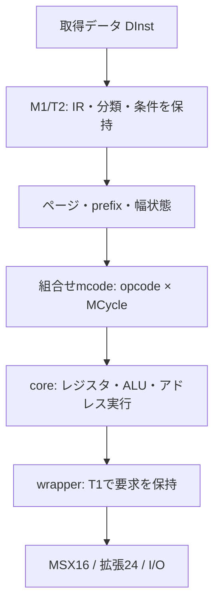

# 命令デコードの実装 — R21.3

対象はfpga/G80A_eZ80。CPU genericのMode=0はT80のZ80系命令セット選択であり、実行時のADL_Mode=0/1とは別。
本資料は現在の構造を説明する。新しい回路やタイミング例外を追加する資料ではない。

## ファイルの役割

| ファイル | 役割 |
| --- | --- |
| t80_ez80.vhd | IR・ページ・prefix・幅状態・事前分類の保持。レジスタ、演算、アドレス、PC、スタック、フレーム実行 |
| t80_pack_ez80.vhd | インターフェースとClassify_Write関数 |
| t80_mcode_ez80.vhd | opcode/ページ/MCycle等から制御信号を作る組合せデコード。書込み信号は別processで統合 |
| t80_reg_ez80.vhd | BC/DE/HL等のレジスタ下位16bit、複数読出しポート |
| t80_alu_ez80.vhd | 8bit ALUとフラグ計算。24bit演算等はcore側の共用演算経路も使う |
| g80a_ez80.vhd | T80内部サイクルをバス信号へ変換。要求アドレス/データ保持、MSX16と拡張24の分離、診断 |
| ../src/ez80_memory_bridge.v | 拡張アドレスの物理配置変換、保持した要求、WAIT、完了受取り |
| ../src/ez80_trace_mux.v | 観測記録の8bit選択。CPU命令デコードではなく診断I/Oの経路 |

## 全体の流れ

命令フェッチ・デコード・実行がそれぞれ3段のパイプラインで並走する構造ではない。
mcodeと実行ロジックはモジュールとして分かれるが、MCycle/TStateや幅状態等が戻る制御を含むT80方式。

## 1. フェッチ時に保持する情報

通常coreでは、許可されたM1/T2かつWAIT解除時にDInstをIRへ取り込む。
割込み/NMI等により取り込む値を置き換える枝は別に存在する。
同じ取り込みでClassify_OpcodeとClassify_Writeの結果をFFへ保持する。
分岐条件のDecode_Flags/Branch_Conditionも受理されたフェッチ境界で保持し、実行中のFの変化で条件が動かないようにする。

| 状態 | 幅 | 用途 |
| --- | ---: | --- |
| IR | 8bit | 実行するopcode |
| ISet | 2bit | 00=通常、01=CB、10=ED。DD/FDはXY_State等へ反映 |
| XY_State | 2bit | HL系の対象をIX/IYへ置換する状態。命令ごとに置換可否あり |
| Width_Pending / Width_Code | 1bit / 8bit | 40/49/52/5Bの幅prefixを次の命令へ渡す |
| Data_Long / Stream_Long | 各1bit | レジスタ/データ・間接系の幅と、即値/絶対アドレスフィールドの幅を区別 |
| ADL_Mode / MADL | 各1bit | 実行モードと混在割込み/復帰フレーム制御 |
| Opcode_Class | 16bit | 複数の命令群判定の事前分類 |
| Write_Class | 8bit | 書込み・命令群選択の事前分類 |
| Branch_Condition | 1bit | 受理した命令の条件成立状態 |

Data_LongとStream_Longは実データバス幅ではない。外部データは8bitで、複数サイクルにより2/3byteを転送する。
Stream_Longが0でも、ADLで実行中の命令フェッチPCは24bitのままの場面がある。即値長と実行時PC幅を混同しない。

## 2. 事前分類

Classify_Opcodeはt80_ez80.vhd、Classify_Writeはt80_pack_ez80.vhdの組合せ関数。
入力はraw opcode。分類だけでは通常ページかEDかを区別せず、利用時にISet/拡張有効/割込み状態等で資格付けする。
同じ数値のopcodeが別ページで異なる命令になるため、この資格付けは省略できない。

| Opcode_Classのbit | 主な候補群（利用時にページ等で確定） |
| --- | --- |
| 0 | EX (SP) |
| 1 | PUSH/POP |
| 2 | ペアINC/DEC |
| 3 | 絶対バイト転送 |
| 4 | HL系絶対ペア転送 |
| 5 | EDペア絶対転送候補 |
| 6 | ADDペア候補 |
| 7 | ADC/SBCペア候補 |
| 8 | ブロック転送/比較とIO2候補 |
| 9 | MLT候補 |
| 10 / 11 | LEA/PEA候補 / PEA候補 |
| 12 | JP即値候補 |
| 13 | CALL/RET/RST候補 |
| 14 | RETI/RETN候補 |
| 15 | LD HL,I候補 |

Write_Classの下位4bitは通常ページの絶対転送・PUSH/POP・EX(SP)・演算・分岐等の群。
上位4bitはED/インデックス拡張の群で、A/Bはペア間接転送、CはIO2に再利用する。
8bitの分類はone-hotではない。各ニブル内のクラス値で選択する。
if/elsifやcaseの記法だけで物理段数は決まらず、共有化・最適化・配線を含むGOWINレポートで判断する。

## 3. mcodeのページとサイクル選択

mcodeの主processはIR、Write_Class、ISet、MCycle、F、XY_State、幅・モード、割込み等を入力とする組合せ回路。
最初に制御出力を既定値へ設定し、ISet別のcase、その中のopcode別case、MCycle別caseで上書きする。

- ISet=00: 通常命令。R17のペア・インデックス間接転送はIndexed_Pair_Activeで先に分岐する。
- ISet=01: CB命令。DD/FD CB d opでは変位取得と幅消費を別に扱う。
- EDページ: 従来ED、TST、ペア間接転送、IO2等。
- その後に既存のXY/幅拡張等の条件付き上書きが残る。全部が単層の独立マトリクスになっているわけではない。

制御出力にはMCycles/TStates、Set_BusA_To/Set_BusB_To、ALU_Op、Read_To_Reg、Save_ALU、Set_Addr_To、IORQ、NoRead、分岐・割込み制御等がある。
MCycle/TStateで複数byteの転送順と内部演算時点を決める。WAITがあるサイクルと、NoReadの内部サイクルを区別する。
このmcodeはVHDLの組合せ論理であり、BSRAMに置いたマイクロコードROM、固定長μOP列、一般的なμOPエンジンではない。

## 4. 書込み信号は別に統合

主デコードのLegacy_Writeを受け、後段の別processでWrite_Class/ISet/MCycle/幅等からWriteを生成する。
これにより、すべての拡張命令のWrite条件を主process末尾へ順に積み増すことを避ける。
ただし最終的なWriteにはフレームFSM側からの選択もあり、全CPU出力が既に一段のFFで分離されているわけではない。

t80_ez80.vhd側は、命令によって通常mcode経路とFrame_State/Frame_TSの経路を選ぶ。
CALL/RST/混在復帰・ADL割込み等は、PC・SPS/SPL・モードタグのフレーム制御を共有する。

## 5. 実行回路の共用

| 対象 | 現在の共用方法 | 限界 |
| --- | --- | --- |
| レジスタペアの2/3byte転送 | ペア選択と幅制御、複数MCycle。上位byteはUpper側も扱う | すべての命令が単一の汎用転送FSMへ統一されたわけではない |
| EX(SP)と追加ペア間接転送 | EX_SP系ワークレジスタを共用 | 読む前に書かない順序・保持期間の検証が必要 |
| 書込みデータ | Data_Out_Reg→wrapper Request_Dataで保持 | 2つのFFの更新条件とストローブ発行の関係を維持する |
| 24bit演算 | 捕捉したオペランドと演算・フラグ経路 | 8bit ALUやアドレス加算とはすべて同じ一個の加算器ではない |
| INI2/IND2/OUTI2/OUTD2 | 既存ブロックI/O転送行、byte ALU、HL更新を共用 | 新命令固有のB/C更新とフラグ条件は追加 |
| SPS/SPLのフレーム更新 | Frame_Stack_Value/Delta/Nextの共通加算 | 通常スタック経路や全制御命令と完全同一ではない |

## 6. R21以降の構造変更

R21はIO2を既存INI/IND/OUTI/OUTDへ読み替えるIRB MUXをページデコード全体の入口に置いた。
R21.1でこれを除去し、EDの該当行に84/8C/A4/ACを直接追加。旧命令と転送行を共有しつつ、raw IRBを他ページへそのまま渡す。
同じ制御出力を保つための比較試験は実施したが、これだけで最初の実機メモリFAILの原因が確定したわけではない。

R21.2/R21.3の観測回路はwrapperの診断I/Oであり、命令デコードの新しい実行段ではない。
R21.3はVerilog側で64bit記録から1byteを選び、8bit Trace_Dataをwrapperへ渡す。Trace_Selectは既存Diag_Selectから出す。

## 7. 要求保持とバス分離

wrapperは下降側CPU許可かつTState=1で、Request_Address/Request_MSX_Address/Request_Extended/Request_Write/Request_IOを捕捉する。
Request_DataはT1/T2で更新し、書込みストローブが有効になるまでに確定させる構造。
Request_Extendedを保持した後、bridgeはMSX側MREQを遮断し、MSX側アドレスを0000Hに保つ。
24bitアドレスの下位FFFFHだけを見てMSXセカンダリスロットを選ばない構成を維持する。

ただしRequest_ExtendedのDには、BankだけでなくVector_Window/Write/IORQ等の判定が入る。
**保持FFがあることと、そのD入力までが短いことは別。** R21.3の最悪Setup経路はこの保持FFまで残っている。
詳細はEZ80_WORST_SETUP_PATH_R21_3.mdと、転記元R21_3_SETUP_PATH1.txtを参照。

## 8. 次の実装で守る点

1. 新命令の追加でグローバルopcode入力へ読み替えMUXを戻さない。
2. ページ内の既存転送・演算行を共用し、必要なopcodeとMCycleに範囲を限定する。
3. デコードのcase階層と、合成後のLogic Levelを区別する。LUTと配線遅延を測る。
4. CPUの組合せ出力を要求保持へ置換する場合、実際の捕捉時点・ストローブ・WAIT・保持期間を先に確認する。
5. CPU CEだけを理由にCPU→周辺回路やSDRAMクロック間を一律multicycleにしない。
6. 新規反復I/Oは反復途中のIRQ/NMI受付位置、要求完了前の再発行、WAIT中のアドレス/データ保持を検証する。
