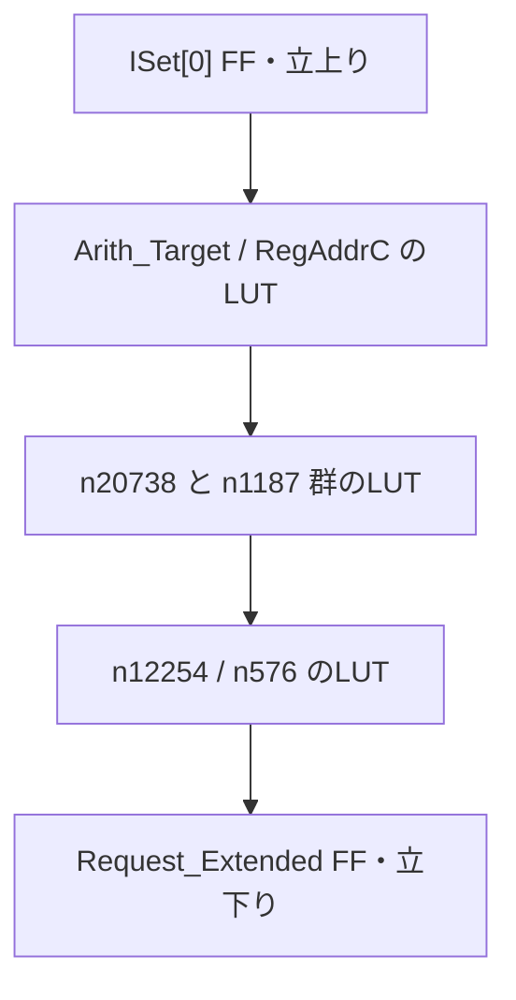

# 最悪Setup経路 — 命令ページ判定からRequest_Extended保持FFまで

## 対象と結果

R21.3のユーザーアップロード `impl(20261115-102551).zip`、GOWIN `MSXNanoTang20K_eZ80.tr` の **Setup Path1** を対象とする。
再合成でセル名・経路・数値は変わる。R21/R21.1/R21.2のPath1と混ぜない。
元のレポートの抜粋をR21_3_SETUP_PATH1.txt、転記値とレポートSHA256をR21_3_SETUP_PATH1.jsonに保存した。

| 項目 | レポート値 |
| --- | --- |
| 始点FF | cpu1/u0/ISet_0_s0 |
| 終点FF | cpu1/Request_Extended_s0 |
| Launch | clock_54m 立上り |
| Capture | clock_54m 立下り |
| Setup Relationship | 9.259ns（54MHzの半周期） |
| Arrival | 19.153ns |
| Required | 11.499ns |
| Slack | **−7.654ns** |
| Logic Level | **10**（GOWINの指標） |
| Source Q fanout | 68 |

Slackは11.499−19.153=−7.654ns。Arrivalには始点クロック配線遅延も含まれ、純粋な組合せ遅延ではない。

## 合成後の実経路

以下は到着経路に列挙された中間セル。配線遅延は直前のQ/Fから各入力まで、到着時刻はそのセルのF出力。

| 順 | 合成セル | 手前の配線遅延ns | セル遅延ns | F到着時刻ns |
| --- | --- | ---: | ---: | ---: |
| 1 | cpu1/u0/Arith_Target_0_s1 | 1.668 | 0.517 | 4.689 |
| 2 | cpu1/u0/RegAddrC_0_s4 | 0.847 | 0.371 | 5.907 |
| 3 | cpu1/u0/n20738_s3 | 3.944 | 0.555 | 10.405 |
| 4 | cpu1/n1187_s34 | 1.901 | 0.517 | 12.824 |
| 5 | cpu1/n1187_s21 | 0.429 | 0.462 | 13.715 |
| 6 | cpu1/n1187_s8 | 0.001 | 0.555 | 14.271 |
| 7 | cpu1/n1187_s5 | 0.419 | 0.453 | 15.143 |
| 8 | cpu1/u0/n12254_s1 | 0.840 | 0.555 | 16.537 |
| 9 | cpu1/n576_s2 | 2.153 | 0.462 | 19.153 |

始点Qの到着は2.503ns（クロック配線2.271ns＋clock-to-Q 0.232ns）。終点Dは19.153ns。
表の中間セル数とGOWINのLogic Levelを同じ意味として数え直さない。Logic Level=10はレポート値をそのまま採用する。
匿名セル名を元VHDLのif/case一つへ一対一に割り当てない。

## RTL上の意味

- ISetは命令ページの状態。通常00、CB01、ED10等を区別する。
- netlistのArith_Target_0_s1はISet[0]/ISet[1]とXY_State[0]/[1]を入力とするLUT。名前にTargetがあっても、ここは追加の保持FFではない。
- RegAddrC_0_s4もWrite_Class等とArith_Targetを入力とするLUT。これもRegAddrCを新たに保持する段ではない。
- その後の合成LUT群は複数のデコード・選択式を共有/最適化したもの。名前だけで「24bit演算を実行する命令の経路」と判断しない。
- 終点Request_Extendedはwrapperが要求をMSX16か拡張24かとして保持する1bit。

wrapperのT1捕捉では、Bank_iが非ゼロなら拡張側、Bank_i=00ならMSX側を基本とする。
ただし診断用Vector_Windowは、Diag_Active、アドレス上位/下位範囲、Write、IORQ、IntCycle_n、RFSHで条件付けする。
I/OとIACKではMSX側に戻す別の上書きがある。
したがってRequest_ExtendedのDはBankの単純な非ゼロ判定だけではなく、命令デコードからの組合せ制御が入り得る。
匿名LUTのすべてを特定のRTL式に断定せず、実測経路は上表、RTLの機能対応はこの段落として区別する。

## 遅延の内訳

| 分類 | 報告遅延ns | 報告割合 |
| --- | ---: | ---: |
| データ側セル | 4.447 | 26.343% |
| データ側配線 | 12.202 | 72.283% |
| clock-to-Q | 0.232 | 1.374% |

最も長い単独配線はRegAddrC_0_s4/Fからn20738_s3/I1への3.944ns。
次いで最終n576の入力まで2.153ns、n1187群への1.901ns等がある。
この経路は「デコードの段数」だけでなく、ファンアウト・配置・配線の影響が大きい。
VHDLのcaseをマトリクス表記に変えるだけで解決するとはしない。

終点側クロックは9.259+2.274=11.534ns、setup 0.035nsを引いて11.499ns。
クロックスキューは+0.003ns。表示値はレポートの丸め値。

## CPUの間引きと制約の判断

coreのISet更新は許可されたCPUフェッチ境界、wrapperのRequest_Extended捕捉はclk_falling=1かつTState=1。
topは3.6MHz相当の信号からclk_enable/clk_fallingを作り、wait_ioで停止させる構成。
このため、STAが選んだ直近の54MHz半周期が、常に実際の命令情報転送の最短保持時間とは限らない。

しかし、次の理由からこの経路を未検証のままfalse_path又は一律multicycleへ変更しない。

1. 最終DにはISetだけでなく幅、XY、Write、I/O、フレーム/割込み等の条件が入る。
2. 各入力の変化可能時点、WAIT/停止復帰、リセット、prefix連鎖と捕捉可能時点を個別に照合する必要がある。
3. CPUのCEと無関係に動作するtop/bridge/SDRAM側には、別の54/27/108MHz捕捉がある。
4. sourceの長い保持を証明しても、endpointのCEや関連holdを自動的に証明したことにならない。

マルチサイクルを使う場合は、対象FF間の有効条件・最短間隔・保持期間を証明し、setup/holdを対で確認できる限定経路だけにする。
本資料更新ではSDCを変更していない。

## 修正案の評価順

1. この要求の意味（MSX/拡張/I/O/診断ベクタ）をT1以前のどの境界で確定できるか調べる。
2. その境界でアドレス/データ/資格情報をそろえて保持し、保持後の最終FFにライブな命令デコードを戻さない形を検討する。
3. サイクルをずらす場合はMREQ/RD/WR、WAIT開始、リフレッシュ、IRQ/NMI、BUSRQとの整合を検証する。
4. 変更後のGOWIN LUT数・配線・Setup/Holdと実機回帰を比較する。現時点で追加FFやパイプラインを実装したとはしない。

## 他の未達と実機結果

R21.3の最悪Holdは−2.712ns、mem1/sdram_addrから108MHz側RamDbi等の経路。今回のCPU内Setupとは別に評価する。
ユーザー実機ではMEM/IO2/MR4/RUNALL全PASS、スペースマンボウPLAYを確認した。
この有限の実機成功は全温度/電圧/配置でのSTA合格、又は以前の不具合原因の確定ではない。

資源はLogic 19439/20736（94%）、LUT17208、ALU1877、Register7393/15915（47%）。
R21.2比でLUTは418減、Registerは31増で、観測用31bit保持もnetlistに残っている。
